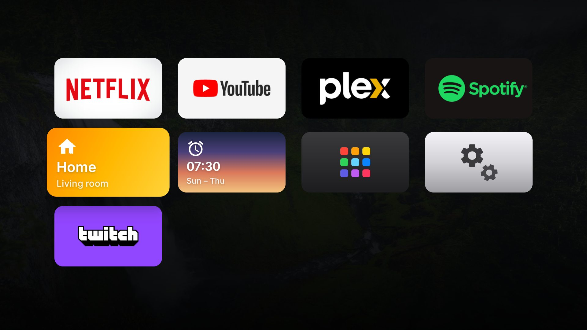
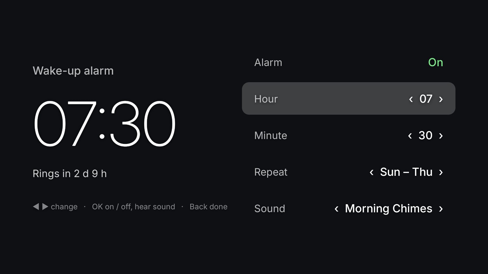
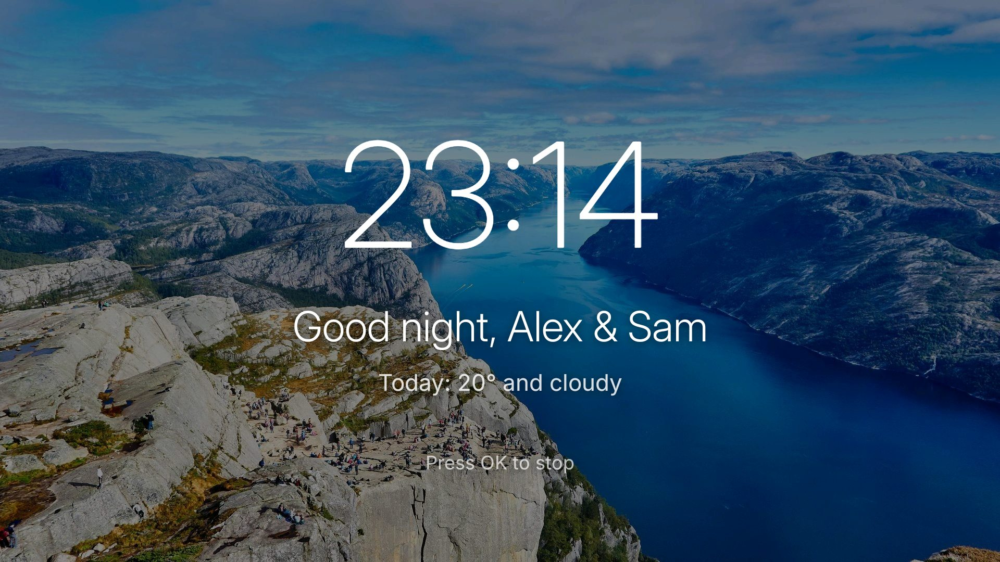
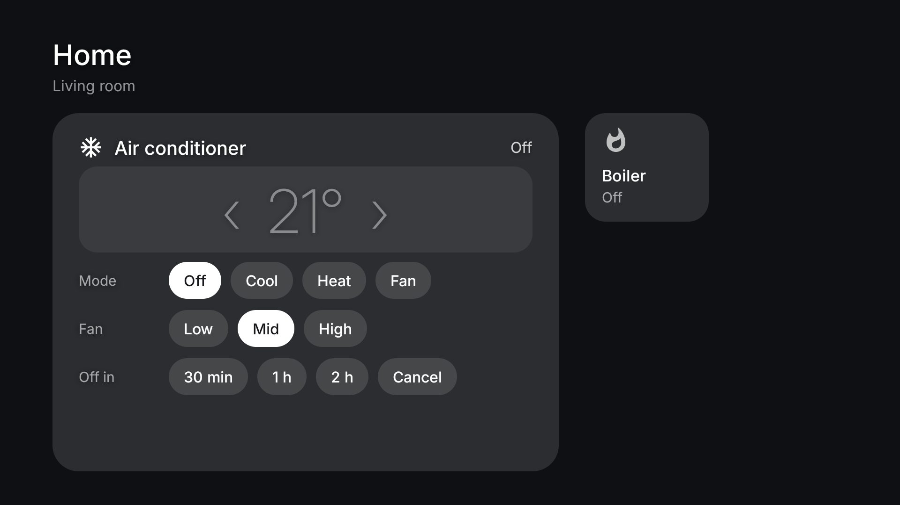
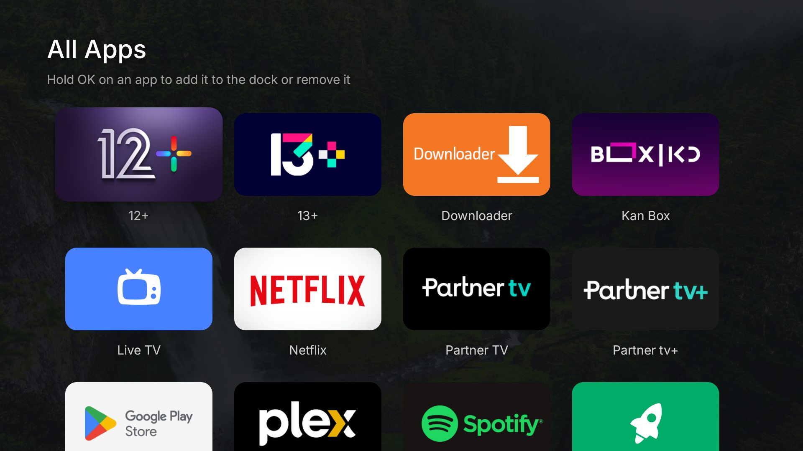

<h1 align="center">Calm TV</h1>

<p align="center">
  <b>A calm, ad-free home screen for Android TV</b><br>
  with a personal welcome, wake-up alarms, a sleep timer on your remote, and Home Assistant built in.
</p>

<p align="center">
  <a href="https://github.com/omer182/calm-tv/actions/workflows/build.yml"></a>
  <a href="https://github.com/omer182/calm-tv/releases/latest"></a>
  <a href="LICENSE"></a>
</p>

<p align="center"></p>

Smart TVs ship with home screens full of ads, sponsored rows and tracking. Calm TV replaces it
with nature photos, a clock, the weather and the apps you actually use, and adds the things a
bedroom TV should have had all along. No root, no account, and everything can be undone.

## What you get

<table>
<tr>
<td width="50%"><br><b>A personal welcome.</b> The TV fades in from black with "Good evening, Alex &amp; Sam" every time it turns on.</td>
<td width="50%"><br><b>Your apps, your order.</b> One row on the home screen; press ▼ and the page scrolls into all your cards, Apple TV style. Hold OK on a card to move or remove it.</td>
</tr>
<tr>
<td><br><b>Wake-up alarm.</b> Set the time, repeat (once, every day, Sun–Thu) and sound with the remote: five gentle tunes or a random song from your Spotify playlist.</td>
<td><br><b>It wakes the TV.</b> With Home Assistant, the TV turns itself on at alarm time (Wake-on-LAN), sets the volume and greets you with the day's weather.</td>
</tr>
<tr>
<td><br><b>Home card.</b> Control the AC (mode, temperature, fan, "off in 30 min / 1 h / 2 h") and switches from Home Assistant, Apple Home style.</td>
<td><br><b>Sleep timer on a remote button.</b> Each press adds 30 min (up to 2 h), hold 3 s to cancel. Works in any app; the last minute counts down so you can stay.</td>
</tr>
<tr>
<td><br><b>A matching screensaver</b> with slowly drifting photos, the time and the weather, instead of Google's.</td>
<td><br><b>All your apps</b> in one grid, and remote buttons (like Netflix) mapped to any app you like.</td>
</tr>
</table>

## Supported TVs

Calm TV runs on **Android TV and Google TV 8.0 or newer**. Some extras depend on the model.

| Status | Devices | Notes |
|---|---|---|
| ✅ Tested | **Xiaomi Mi TV** (MiTV-MSSP3, Android TV 9) | Everything, including Wake-on-LAN alarms, sleep button (key 194) and Netflix button (key 193). Debloat list included. |
| 🟡 Should work | Other Android TV / Google TV: Xiaomi, TCL, Sony, Philips, Hisense, Nvidia Shield, Chromecast with Google TV, Google TV Streamer | Home screen, welcome, weather, screensaver and Home card should work. Wake-on-LAN, button codes and debloat lists differ per model. |
| 🟠 Partly | Amazon Fire TV | Installs, but Fire OS fights custom home screens. |
| ❌ Not possible | Samsung (Tizen), LG (webOS), Roku, Vizio, Panasonic, Apple TV | These don't run Android apps. |

Tried it on another TV? Please [report it](https://github.com/omer182/calm-tv/issues/new?template=tv-report.yml)
so it can move up the list.

## Quick start

You need a computer on the same network with [Android platform-tools](https://developer.android.com/tools/releases/platform-tools)
(`adb`) installed.

**1. Turn on debugging on the TV.** Settings → Device Preferences → About → click **Build** 7 times.
Then Developer options → turn on **USB debugging** (and **Network debugging** if your TV lists it).
Note the TV's IP address (Settings → Network).

**2. Make your settings file.**

```bash
git clone https://github.com/omer182/calm-tv.git && cd calm-tv
cp config/calm.example.json config/my-tv.json   # then edit names, city, apps…
```

**3. Install.** Accept the "Allow debugging?" prompt on the TV the first time.

```bash
./setup.sh 192.168.1.50            # macOS / Linux
.\setup.ps1 -Tv 192.168.1.50       # Windows (PowerShell)
```

That's it. Press Home on the remote. The setup script downloads the latest release, copies your
settings, makes Calm TV the home screen and turns on the sleep button and screensaver.

> **Let an agent do it.** Open this repo in Claude Code (or any coding agent) and say
> *"set up Calm TV on my TV"*. [AGENTS.md](AGENTS.md) tells it what to ask you and what's safe.

## Settings (`calm.json`)

Every field is optional; leave one out and that feature simply switches off.

| Field | Example | What it does |
|---|---|---|
| `names` | `"Alex & Sam"` | The welcome: "Good evening, Alex & Sam". Empty: just "Good evening". |
| `location` | `{"name": "Lisbon", "lat": 38.72, "lon": -9.14}` | Weather from [Open-Meteo](https://open-meteo.com) (free, no key). |
| `alarm.spotifyPlaylist` | `"37i9dQZF1DX0UrRvztWcAU"` | Playlist id for the random-song alarm (from the playlist's share link). Without it: a random morning song on YouTube. |
| `alarm.volume` | `20` | Volume the alarm sets before playing. |
| `homeAssistant` | `{"url", "room", "alarmWebhook", "homeWebhook"}` | Turns on the Home card and alarm wake-up. See below. |
| `cameras` | `{"go2rtc": "http://192.168.1.10:1984", "streams": [{"name": "Kids room", "src": "kids_cam"}]}` | Turns on the Cameras card: live view of [go2rtc](https://github.com/AlexxIT/go2rtc) streams (`src` is the stream name in go2rtc.yaml). Two per row: the selected one is live, the others refresh a still every 10 s (TVs often decode one video at a time). OK for full screen, with sound. |
| `sleepKey` | `194` | Key code of the remote button for the sleep timer. |
| `buttons` | `{"193": "com.netflix.ninja"}` | Remote buttons that open an app. |
| `dock` | `["com.netflix.ninja", "@home", "@cameras", "@alarm", "@all", "@settings"]` | First-run card order. `@…` are the built-in cards. |

Change settings any time: edit the file and run setup again, or just
`adb push config/my-tv.json /sdcard/Android/data/io.github.omer182.calmtv/files/calm.json`.

### Finding a button's key code

Run `adb logcat | grep interceptKeyTq` and press the button. You'll see e.g. `keycode=194`.
Pick a button the TV doesn't use (Assistant buttons are usually swallowed by the system and
won't work).

## Home Assistant (optional)

Android TVs can't wake themselves from standby, so for alarms Home Assistant sends a
Wake-on-LAN packet at alarm time. The same package powers the Home card.

1. Run setup with Wake-on-LAN: `./setup.sh <tv-ip> --wake-on-lan` (prints the TV's MAC; the TV
   should be on a network cable).
2. Copy [`homeassistant/calm_tv.yaml`](homeassistant/calm_tv.yaml) into `<config>/packages/`,
   replace the `CHANGE_ME` values (webhook ids, MAC, TV IP, your AC and switches) and restart
   Home Assistant.
3. Put the same webhook ids and your Home Assistant URL in `calm.json`.

Give the TV a fixed IP in your router: Home Assistant sends the AC status to it.

## Debloat (optional)

[debloat/](debloat) has per-model lists of ad, tracking and updater packages to **disable**
(never uninstall). Only use a list made for your model.

## Undo everything

```bash
.\restore.ps1 -Tv 192.168.1.50 [-Packages debloat\xiaomi-mitv-mssp3.txt]
```

Removes Calm TV, turns the stock home screen and Google's screensaver back on, and re-enables
any debloated packages. A factory reset also undoes everything.

## What the setup changes, and why

| Change | Why |
|---|---|
| Disables the stock launcher (`com.google.android.tvlauncher` etc.) | Android TV keeps opening its own home screen while it's enabled. |
| Accessibility service "Calm sleep timer" | The only way an app can see remote buttons while other apps are open. It reads key presses only, never screen content. |
| Device admin with only "lock screen" | So the sleep timer can put the TV into standby. |
| `WRITE_SECURE_SETTINGS` (granted over adb) | Lets the app switch its button service back on after updates. |
| Screensaver set to Calm TV | Replaces Google's Backdrop screensaver. |
| `network_wol=1` (only with `--wake-on-lan`) | Lets Home Assistant wake the TV for alarms. |

The app listens on port 8765 on your home network for status updates from Home Assistant. It
has no password, so anyone on your network could show fake AC status on the TV (but not
control anything). Webhooks are `local_only` in Home Assistant.

## Building from source

No Gradle: a single PowerShell script runs aapt2, javac, d8 and apksigner. Needs JDK 17 and the
Android SDK (`build-tools;34.0.0`, `platforms;android-34`).

```bash
pwsh launcher/build.ps1 -Version 0.2.0      # → launcher/build/calm-tv.apk
./setup.sh 192.168.1.50 --apk launcher/build/calm-tv.apk
```

Every push is built by GitHub Actions; tags like `v0.2.0` publish a signed release.

## Credits

Inter font (SIL OFL), Material Icons (Apache 2.0), photos from Unsplash. See [CREDITS.md](CREDITS.md).
Inspired by [dumbtv](https://github.com/humblemuzzu/dumbtv). Code: [MIT](LICENSE).
